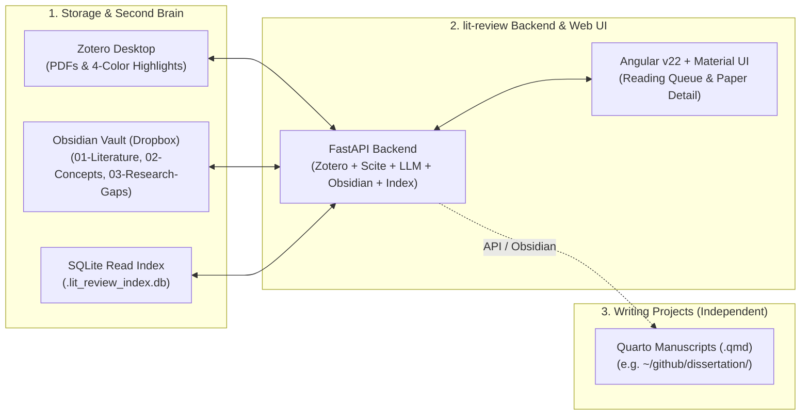

# Literature Review & Knowledge Synthesis System

A personal research cockpit combining **Zotero**, **Scite.ai**, **Purdue GenAI**, **Obsidian**, and an **Angular + FastAPI** web UI for paper triage, citation tracking, and research gap discovery.

## System Architecture



---

## Repository Map

- `backend/` — FastAPI application (`app/main.py`, `app/routers/`, `app/services/`, `app/models/`).
- `frontend/` — Angular v22.2 + Angular Material web application (`src/app/core/`, `src/app/features/`).
- `obsidian/` — Symlink to your private Dropbox Obsidian vault (`01-Literature/`, `02-Concepts/`, `03-Research-Gaps/`).
- `research_focus.json` — Active research topics used for LLM relevance scoring.
- `Makefile` — Shortcuts for running servers, syncing, analyzing, and refreshing citations.
- `.lit_review_index.db` / `.sync_state.json` — Local SQLite read cache and Zotero incremental sync state (gitignored).

### Other Project Documents

- **[backend/README.md](backend/README.md)** — Full FastAPI endpoint reference and backend service details.
- **[frontend/README.md](frontend/README.md)** — Frontend stack, build, and test commands.
- **[AGENTS.md](AGENTS.md)** — Root instructions and invariants for coding agents.
- **[frontend/AGENTS.md](frontend/AGENTS.md)** — Angular-specific coding rules for agents.
- **[CODE_AUDIT.md](CODE_AUDIT.md)** — Active 4-phase code audit and refactoring roadmap.

---

## Common Commands

Run from the repository root:

```bash
make dev         # Run FastAPI backend (:8000) and Angular frontend (:4200) concurrently
make backend     # Start FastAPI backend only (uv run uvicorn ...)
make frontend    # Start Angular frontend only (npm start)
make sync        # Run Zotero -> Scite -> Obsidian + SQLite incremental delta sync
make analyze     # Run LLM scoring & extraction on unanalyzed papers only
make citations   # Refresh Scite citation counts and recalculate priority scores
```

---

## Key API Endpoints

- `GET /api/papers` — Ranked paper list (served from `.lit_review_index.db`)
- `GET /api/papers/{citekey}` — Parsed Obsidian note + metadata
- `POST /api/sync` — Incremental Zotero → Scite → Obsidian delta sync
- `GET` / `POST` / `DELETE /api/config/research-focuses` — Manage active research topics

See **[backend/README.md](backend/README.md)** for the full endpoint list.

---

## 📁 Obsidian Vault Structure (The 3 Folders)

Actual manuscript drafts (**Quarto `.qmd` files**) live in independent project repositories outside Obsidian. Obsidian is organized into 3 folders:

1. **`01-Literature/` (Atomic Paper Notes):** One note per paper (`@citekey.md`) containing YAML frontmatter (`priority_score`, `status`, `llm_analyzed`, `llm_analyzed_at`, `llm_source`, `scite_*`), Abstract, categorized Zotero PDF highlights with `zotero://open-pdf/...` deep links, `## 🤖 LLM Analysis`, and protected `## 📝 My Personal Reading Notes`.
2. **`02-Concepts/` (Idea & Method Hubs):** Topic and technology notes (e.g. `[[Transformer]]`, `[[Hyperspectral]]`) pooling backlinks.
3. **`03-Research-Gaps/` (Synthesis & Discovery):** Dataview summary tables pooling limitations and contrasting evidence.

---

## 🎨 PDF Highlighting Color Protocol

When reading papers in Zotero's PDF reader, use this color-coding scheme:

|     Color     | Hex Code  | Category              | What to Highlight                                  | Target Section in Obsidian          |
| :-----------: | :-------: | :-------------------- | :------------------------------------------------- | :---------------------------------- |
| 🟡 **Yellow** | `#ffd400` | **Core Findings**     | Main numerical findings, takeaways, or conclusions | `## 💡 Key Findings`                |
| 🟢 **Green**  | `#5fb236` | **Methodology**       | Models, algorithms, experimental setups, datasets  | `## 🔬 Methods`                     |
|  🔴 **Red**   | `#ff6666` | **Limitations**       | Unresolved weaknesses, assumptions, research gaps  | `## ⚠️ Limitations & Research Gaps` |
| 🟣 **Purple** | `#a28ae5` | **Quotes for Citing** | High-impact verbatim quotes for Quarto papers      | `## 📌 Quotes`                      |
|  🔵 **Blue**  | `#2ea8e5` | **Context**           | Background problem statement or industry stats     | `## 📖 Context`                     |

---

## Setup Requirements

### 1. Obsidian Vault Symlink

```bash
# In the root of this repository:
ln -s "/path/to/your/Dropbox/vault" obsidian
```

### 2. Credentials & Secrets

All API credentials are stored securely in the Linux system keyring (`lit-review` service):

```bash
keyring set lit-review ZOTERO_LIBRARY_ID
keyring set lit-review ZOTERO_API_KEY
keyring set lit-review SCITE_API_KEY
keyring set lit-review GENAI_API_KEY
```

---

## 📊 Paper Priority Scoring

Papers are ranked continuously from **high to low** using:

$$\text{Priority Score} = S_{\text{relevance}} + S_{\text{citations}} + S_{\text{recency}} + S_{\text{bonus}}$$

| Component | Range | Calculation | Purpose |
| :--- | :---: | :--- | :--- |
| **1. LLM Relevance** | **0 – 50 pts** | Purdue GenAI (`qwen3.8:27b`) evaluates full-text (or abstract fallback) against [`research_focus.json`](research_focus.json) (`0–5` scale $\times 10$). | Floats papers most relevant to your current research to the top. |
| **2. Citation Count** | **0 – 35 pts** | Logarithmic scaling of total citations: $\min(35,\; 11.5 \times \log_{10}(\text{citations} + 1))$. | Gives strong weight to influential papers without letting 10,000-cite surveys dominate. |
| **3. Recency** | **0 – 15 pts** | 0–1 yr old: `15` \| 2–3 yrs: `10` \| 4–5 yrs: `5` \| >5 yrs: `0`. | Keeps your reading list current with recent publications. |
| **4. Manual Bonus** | **Adjustable** | User-defined boost or penalty (e.g., `+5`, `-5`) adjustable inline in the web UI. | Overrides automation whenever you want to bump a paper up or down. |
