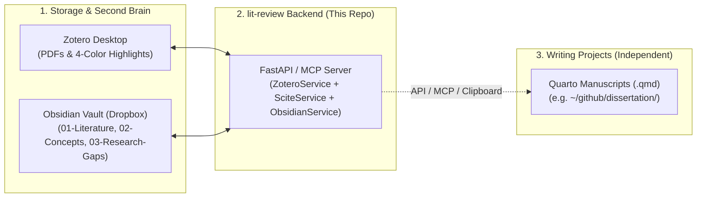

# Literature Review & Knowledge Synthesis System

A personal research cockpit combining **Zotero**, **Obsidian**, and **Scite.ai** for fast Quarto citation and research gap discovery.

## System Architecture



---

## 📁 Obsidian Vault Structure (The 3 Folders)

Actual manuscript drafts (**Quarto `.qmd` files**) live in independent project repositories outside Obsidian, allowing clean collaboration and version control with co-authors. Obsidian is strictly organized into 3 folders:

1. **`01-Literature/` (Atomic Paper Notes)**:
   - One note per paper named `@citekey.md`.
   - Contains YAML frontmatter, 4-color highlighted quotes, Zotero PDF page deep-links, and protected user reading notes.
2. **`02-Concepts/` (Idea & Method Hubs)**:
   - Topic and technology notes (e.g. `[[Transformer]]`, `[[Hyperspectral]]`).
   - Backlinks panel automatically pools all papers utilizing or discussing that concept.
3. **`03-Research-Gaps/` (Synthesis & Discovery)**:
   - Dataview summary tables pooling `## ⚠️ Limitations` and Scite contrasting debates to reveal unaddressed research questions.

---

## 🎨 PDF Highlighting Color Protocol

When reading papers in Zotero's PDF reader, use this color-coding scheme:

| Color | Hex Code | Category | What to Highlight | Target Section in Obsidian |
| :---: | :---: | :--- | :--- | :--- |
| 🟡 **Yellow** | `#ffd400` | **Core Findings** | Main numerical findings, takeaways, or conclusions | `## 💡 Quick Finding` |
| 🟢 **Green** | `#5fb236` | **Methodology** | Models, algorithms, experimental setups, datasets | `## 🔬 Methodology & Setup` |
| 🔴 **Red/Pink** | `#ff6666` | **Limitations** | Unresolved weaknesses, assumptions, research gaps | `## ⚠️ Limitations & Research Gaps` |
| 🟣 **Purple** | `#a28ae5` | **Quotes for Citing** | High-impact verbatim quotes for Quarto papers | `## 📌 Highlighted Quotes` |
| 🔵 **Blue** | `#2ea8e5` | **Context** | Background problem statement or industry stats | `## 📌 Highlighted Quotes` |

---

## Setup Requirements

### 1. Obsidian Vault Symlink
This repository expects a symlink named `obsidian` pointing to your private Obsidian vault (stored in your Dropbox or local drive):

```bash
# In the root of this repository:
ln -s "/path/to/your/Dropbox/vault" obsidian
```

*Note: The actual path to your vault is kept private and never hard-coded in the repository configuration.*

### 2. Credentials & Secrets
All API credentials (Zotero, Scite.ai, GenAI) are retrieved securely from the Linux system keyring (`lit-review` service). Zero plain-text keys are stored in this repository.

To set your credentials using your Linux terminal:
```bash
keyring set lit-review ZOTERO_LIBRARY_ID
keyring set lit-review ZOTERO_API_KEY
keyring set lit-review SCITE_API_KEY
```
